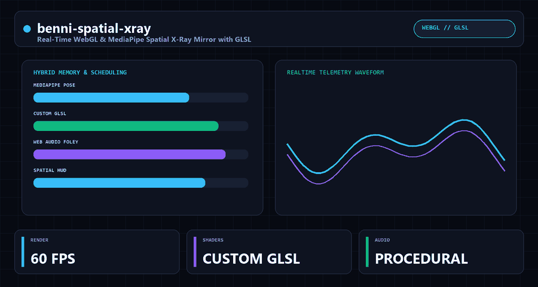

<div align="center">


<br/>

[](#)
[](#)
[](LICENSE)
[](https://benni-os.net)

<br/>

> **Real-Time WebGL & MediaPipe Spatial X-Ray Mirror with GLSL.**  
> Part of the **Benni Master OS** sovereign engineering ecosystem.

<br/>



</div>

---

Real-time client-side **WebGL 3D + MediaPipe Vision + Custom GLSL Shaders + Procedural Web Audio Foley** anatomical mirror running at 60 FPS with zero external mesh dependencies.

## Features

- **Single-File Zero-Latency Architecture (~2.6 MB)**: 23 quantized `Uint16Array` 3D anatomical meshes (cranium, articulating jaw, cerebrum, hindbrain, facial musculature, eyes, dermal outline, and 15 hand phalanges + palm) packed directly into the HTML bundle.
- **Real-Time Neural Vision Tracking**:
  - **MediaPipe FaceLandmarker** (478 facial landmarks + `jawOpen` blendshape driving a physical 3D mandible pivot).
  - **MediaPipe HandLandmarker** (21 3D landmarks per hand for skeletal rigging & tomographic lens control).
- **Multi-Mode Custom GLSL Shaders**:
  - `X-RAY`: Medical Fresnel rim lighting (`pow(1.0 - ndv, 2.1)`) with volumetric falloff.
  - `CYBER`: Holographic scanlines & neon edge glow.
  - `BIOLUM`: Subsurface scattering approximation in pulsing crimson/amber.
  - `THERMAL`: Dynamic FLIR false-color heat spectrum.
- **Tomographic Hand Lens**: Move your hand in front of your face in `Lens` mode to dynamically section dermal/muscular layers and expose bone and brain anatomy.
- **Procedural Web Audio Foley**: 100% synthesized client-side audio (55Hz magnetic scanner hum, tactile biomechanical clicks, and resonant tomographic sweep chimes).
- **Dynamic 2D Callout HUD**: 26 anatomical landmarks projected to screen space with leader lines.
- **Headless `#demo` Mode**: Append `#demo` to the URL (or click *Run Headless Demo*) for procedural Lissajous simulation without a camera.

## Quick Start

Open `index.html` in a modern browser (Chrome/Edge) over `https://` or `http://localhost` (required for camera permissions), or append `#demo` to run the procedural simulation immediately.

```bash
# Serve locally
python -m http.server 8080
# Then open http://localhost:8080/
```
